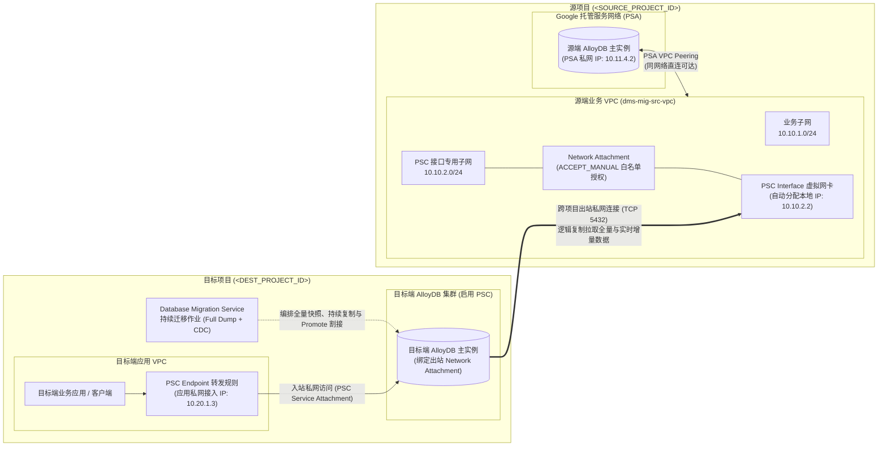

# 跨项目 AlloyDB 在线迁移指南（DMS + PSC Interface 实战方案）

本仓库提供了一套经过端到端真机实测验证的 **Google Cloud AlloyDB for PostgreSQL 跨项目近零停机迁移方案**。当源端 AlloyDB 采用 **Private Services Access (PSA)** 私网连接方式运行在源项目（`<SOURCE_PROJECT_ID>`），需要将业务平滑迁移至目标项目（`<DEST_PROJECT_ID>`）的 AlloyDB 集群时，可借助 **Database Migration Service (DMS)** 配合 **Private Service Connect (PSC) Interface（PSC 接口）** 完成全量初始化与实时增量（CDC）同步，并在分钟级窗口内完成主库割接（Promote）。

---

## 目录

- [1. 为什么跨项目 AlloyDB 迁移推荐使用 DMS + PSC Interface？](#1-为什么跨项目-alloydb-迁移推荐使用-dms--psc-interface)
- [2. 目标网络与数据流架构](#2-目标网络与数据流架构)
- [3. 方案选型对比](#3-方案选型对比)
- [4. 仓库目录结构](#4-仓库目录结构)
- [5. 前置条件](#5-前置条件)
- [6. 五步快速上手](#6-五步快速上手)
- [7. 核心避坑要点总结](#7-核心避坑要点总结)
- [8. 生产割接后的安全加固建议](#8-生产割接后的安全加固建议)
- [9. 参考官方文档](#9-参考官方文档)

---

## 1. 为什么跨项目 AlloyDB 迁移推荐使用 DMS + PSC Interface？

在实际企业上云、部门拆分、账单隔离或安全合规改造场景中，用户常面临两个核心限制：

1. **AlloyDB 原生跨区域副本不支持跨项目创建**：AlloyDB 的只读实例（Read Pool）属于集群内部节点，而二级集群（Secondary Cluster）严格要求与主集群位于**同一个 GCP 项目**内，因此无法通过“跨项目建只读副本再提升为主库”的方式迁移。
2. **PSA 架构存在 VPC Peering 非传递性（Non-Transitive Peering）壁垒**：
   - 源端 PSA AlloyDB 运行在 Google 托管的服务网络中，通过 VPC Peering 与源项目业务 VPC 相连。
   - Google Cloud 的 VPC Peering 不具备路由传递能力：即使将目标项目的 VPC 与源项目的 VPC 对等连接，目标端数据库或迁移服务依然无法穿透源端 VPC 访问背后的 PSA 托管网络，且容易引发多环境 CIDR 地址段冲突。

**DMS + PSC Interface 的破局优势**：
- **免代理、零跨项目 VPC Peering**：只需在源端 PSA 所在的 VPC 中创建一个 **Network Attachment（网络挂载点）**，并在目标端启用 PSC 的 AlloyDB 实例上绑定该挂载点，Google Cloud 即可为目标端 AlloyDB 自动分配一张直通源端 VPC 的私网虚拟网卡（PSC Interface）。
- **天然打通 PSA 路由**：由于这张虚拟网卡直接落位在源端 VPC 的子网内，它属于源端 VPC 的本地节点，天然继承源端 VPC 通往 PSA 托管网络的路由，无需额外部署和维护反向 SSH 跳板机或 HA VPN。
- **近零停机在线割接**：自动完成历史存量数据全量导入（Full Dump）与事务日志实时增量同步（CDC），业务仅需在最终切换（Promote）阶段短暂停止源库写入即可平滑切流。

---

## 2. 目标网络与数据流架构



- **出站复制流量（目标端 -> 源端）**：目标端 AlloyDB 实例通过跨项目绑定的 `Network Attachment` 在源端 VPC 获得本地私网 IP（如 `10.10.2.2`），经源端 VPC 内部路由直接连接源端 PSA AlloyDB（如 `10.11.4.2:5432`）拉取全量与 CDC 增量日志。
- **入站业务流量（业务应用 -> 目标端）**：割接完成后，目标项目（或多项目 Shared VPC）中的应用通过 **PSC Endpoint** 或 **AlloyDB Auth Proxy（配合 PSC DNS）** 安全连接新的目标端 AlloyDB 主集群。

---

## 3. 方案选型对比

在规划 AlloyDB 跨项目迁移时，可根据停机窗口要求与网络形态按下表选择合适路径：

| 迁移方案 | 停机窗口 | 是否需要代理 VM | 适用场景与特点 |
| :--- | :--- | :--- | :--- |
| **DMS 标准迁移 + PSC Interface（本仓库方案，GA 正式版）** | **近零停机（分钟级切换）** | 否 | **生产首选**。基于成熟的 `pglogical` 逻辑复制，支持全量 + 实时 CDC 在线追平，支持手动审批白名单（`ACCEPT_MANUAL`），无需跨项目授予网络管理员权限。 |
| **DMS 快速迁移（Quick-Start Migration，预览版）** | 近零停机 | 否 | 采用 PostgreSQL 原生逻辑复制（免装 `pglogical`），由 DMS 自动在源端 VPC 创建 Network Attachment，但处于 Preview 阶段且需要跨项目向 DMS 服务账号授予网络管理权限。 |
| **DMS + 自建多网卡 / VPN TCP 代理 VM** | 近零停机 | 是（需自行保障高可用） | 仅当**目标端 AlloyDB 因历史架构原因也必须使用 PSA（不能开启 PSC）**时采用，需自行维护代理虚机转发流量。 |
| **AlloyDB 跨项目备份恢复 / 时间点恢复（PITR）** | **需停机窗口（取决于恢复耗时）** | 否 | 适合允许数十分钟至数小时计划内停机的非核心系统或离线测试环境克隆，通过命令行直接将源项目备份恢复至目标项目新集群。 |

---

## 4. 仓库目录结构

```text
.
├── README.md                              # 项目总览、架构解析、选型建议与快速导航
├── docs/
│   ├── step-by-step-guide.md              # 保姆级实施手册（含 Console 与 gcloud CLI 双路径、排障 FAQ）
│   └── test-report.md                     # 端到端真机迁移测试报告（含各阶段耗时、37,965+ 行数据 MD5 对账与割接验证）
└── scripts/
    ├── env.example.sh                     # 参数模板与交互式输入校验器（无任何硬编码个人或项目敏感信息）
    ├── 01-setup-source-psa.sh             # [可选 PoC] 在源项目搭建 PSA VPC、防火墙与源端 AlloyDB
    ├── 02-setup-dest-psc-and-na.sh        # 在目标项目创建 PSC AlloyDB 集群、源端 Network Attachment 与目标主实例
    ├── 03-prepare-source-pglogical.sql    # 源端数据库初始化 pglogical 扩展与迁移专用账号赋权 SQL
    ├── 04-seed-sample-dataset.sql         # [可选 PoC] 生成多库多 Schema 电商仿真数据集（表、索引、视图、序列）
    ├── 05-simulate-cdc-writes.sql         # [可选 PoC] 在 CDC 阶段模拟线上持续增删改（INSERT/UPDATE/DELETE）流量
    ├── 06-verify-checksums.sql            # 源库与目标库全表行数、金额汇总、整表 MD5 指纹及序列状态对账 SQL
    ├── 07-run-dms-migration.sh            # 创建 DMS 连接配置、迁移作业、执行降级预检（Verify）并启动持续复制
    └── 99-cleanup.sh                      # [可选 PoC] 按严格依赖顺序一键清理测试验证资源
```

---

## 5. 前置条件

1. **GCP 项目与区域**：
   - 准备源项目 `<SOURCE_PROJECT_ID>` 与目标项目 `<DEST_PROJECT_ID>`。
   - 目标端 AlloyDB 集群、DMS 连接配置与迁移作业必须与源端 AlloyDB 及 Network Attachment 位于**同一区域（Region）**（例如同在 `us-central1` 或 `asia-east1`）。
2. **需启用的 Google Cloud API**：
   - 源项目与目标项目均需启用：`alloydb.googleapis.com`、`compute.googleapis.com`、`servicenetworking.googleapis.com`。
   - 目标项目额外启用：`datamigration.googleapis.com`。
3. **IAM 权限要求**：
   - 操作人员在源项目具备创建子网、防火墙与 Network Attachment 的网络权限，以及源端 AlloyDB 参数修改与数据库管理员连接权限。
   - 操作人员在目标项目具备 AlloyDB Admin（`roles/alloydb.admin`）与 Database Migration Admin（`roles/datamigration.admin`）权限。
4. **数据库对象要求（`pglogical` 逻辑复制规范）**：
   - 需要同步增删改（`UPDATE` / `DELETE`）的表应具备**主键（Primary Key）**；对于无主键表，DMS 仅同步全量快照与后续 `INSERT` 操作。

---

## 6. 五步快速上手

> 完整图文式细节、Google Cloud Console 界面点击路径及生产环境存量库迁移说明，请直接阅读 **[📘 跨项目 AlloyDB 迁移保姆级操作手册 (docs/step-by-step-guide.md)](docs/step-by-step-guide.md)**。

### 第一步：克隆仓库并加载环境变量

```bash
git clone https://github.com/nonokangwei/GMS-AlloyDB.git
cd GMS-AlloyDB

# 交互式输入您的 <SOURCE_PROJECT_ID>、<DEST_PROJECT_ID>、区域及数据库密码
source ./scripts/env.example.sh
```

### 第二步：准备源端 PSA AlloyDB（如已有源端生产库，仅需核对参数）

- 若需从零搭建测试验证源库，可运行：
  ```bash
  ./scripts/01-setup-source-psa.sh
  ```
- 若迁移**已有源端 PSA AlloyDB**，请确保源端主实例已配置逻辑复制参数（`alloydb.logical_decoding=on`、`alloydb.enable_pglogical=on`、`max_replication_slots>=50`、`max_wal_senders>=50`），并在源端每个待迁移数据库中执行 `scripts/03-prepare-source-pglogical.sql`。

### 第三步：创建目标端 PSC AlloyDB 与跨项目 Network Attachment

```bash
./scripts/02-setup-dest-psc-and-na.sh
```
该脚本会自动完成：创建启用 PSC 的目标端 AlloyDB 集群 -> 提取集群专属后台服务项目编号（`serviceOwnedProjectNumber`） -> 在源端 VPC 创建 `ACCEPT_MANUAL` 白名单模式的 Network Attachment -> 创建绑定该跨项目 Network Attachment 的目标端 AlloyDB 主实例。

### 第四步：创建并启动 DMS 持续迁移作业

```bash
./scripts/07-run-dms-migration.sh
```
脚本将自动创建源端与目标端 Connection Profile、创建 `CONTINUOUS` 持续迁移作业、将目标端集群切换为外部副本接收模式（`demote-destination`）、运行端到端连通性与权限预检（`verify`），并启动全量加载与实时 CDC 同步。

### 第五步：数据一致性对账与在线割接（Promote）

1. 当作业状态显示 `RUNNING` 且阶段进入 `CDC` 后，在源库与目标库分别运行 `scripts/06-verify-checksums.sql` 比对全表行数与整表 MD5 摘要。
2. 在计划割接窗口暂停源端业务写入，确认源库 `pg_stat_replication` 中复制延迟归零（`sent_lsn = replay_lsn`）后，执行一键割接：
   ```bash
   gcloud database-migration migration-jobs promote "${DMS_MIGRATION_JOB_ID}" \
     --project="${DEST_PROJECT_ID}" \
     --region="${REGION}"
   ```
3. 待迁移作业变为 `COMPLETED`，目标端 AlloyDB 即自动恢复为独立可读写的主集群（`PRIMARY`），将业务连接切换至目标端 PSC 接入点即可恢复对外服务。

---

## 7. 核心避坑要点总结

在实测验证过程中，以下几个细节最容易导致配置报错，实施时请重点关注：

1. **Network Attachment 白名单必须填写目标集群的 `serviceOwnedProjectNumber`，而非 `<DEST_PROJECT_ID>`**
   - 当采用生产推荐的手动审批模式（`ACCEPT_MANUAL`）创建源端 Network Attachment 时，真正发起跨项目网卡挂载请求的是 Google 为目标 AlloyDB 集群分配的专属托管租户项目编号（可通过 `gcloud alloydb clusters describe <DST_CLUSTER_ID> --format="value(pscConfig.serviceOwnedProjectNumber)"` 查询），如果误填 `<DEST_PROJECT_ID>`，连接将被拒绝（`REJECTED`）。
2. **源端 AlloyDB 的 `max_replication_slots` 与 `max_wal_senders` 最小允许值为 `50`**
   - 标准 PostgreSQL 文档常建议将这两个参数设为 `10` 或 `20`，但在 AlloyDB 中它们的系统下限是 `50`。若设置小于 `50` 的数值，API 会直接返回参数校验失败。建议统一设置为 `60` 或更高（取决于并发迁移的数据库数量）。
3. **使用 CLI 迁移至已有 AlloyDB 集群时，必须在 `verify` / `start` 前执行 `demote-destination`**
   - 在 Google Cloud Console 网页向导中，系统会自动将预先创建的目标 AlloyDB 集群临时降级为外部复制目标；若通过 `gcloud` 命令行或自动化脚本操作，必须显式调用 `gcloud database-migration migration-jobs demote-destination`，否则预检会报 `Destination has to be demoted` 错误。
4. **提前在目标端重建业务数据库普通账号**
   - DMS 的逻辑复制会自动迁移所有的库、Schema、表结构、主键/索引、视图、序列及业务数据，但**不会自动同步除 `postgres` 以外的自定义数据库角色与密码**。请在业务切流前在目标集群预先创建应用所需的业务账号或 IAM 数据库账号。

---

## 8. 生产割接后的安全加固建议

- **优先使用 AlloyDB Auth Proxy 或 Language Connectors 连接目标库**：启用 PSC 的目标集群天然提供专属 `pscDnsName`，结合 AlloyDB Auth Proxy 可自动启用 TLS 1.3 加密传输与 IAM 数据库身份认证，免去静态密码轮换负担。
- **按需回收跨项目迁移通道**：割接完成并稳定运行观察期结束后，可删除 DMS 迁移作业及源端为迁移临时创建的防火墙放行规则，实现源项目与目标项目网络的彻底解耦。

---

## 9. 参考官方文档

- [Configure your source with Private Service Connect interfaces (PostgreSQL to AlloyDB)](https://docs.cloud.google.com/database-migration/docs/postgresql-to-alloydb/configure-src-connection-csql-postgres#private-psc-interfaces)
- [About Private Service Connect in AlloyDB](https://docs.cloud.google.com/alloydb/docs/psc-overview)
- [Connect to an AlloyDB cluster using Private Service Connect](https://docs.cloud.google.com/alloydb/docs/connect-psc)
- [本文档配套：保姆级实施手册](docs/step-by-step-guide.md) | [端到端实测验证报告](docs/test-report.md)
